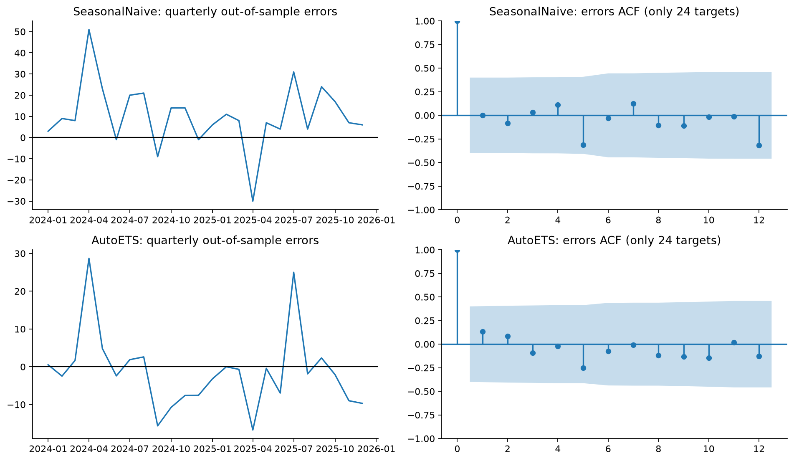
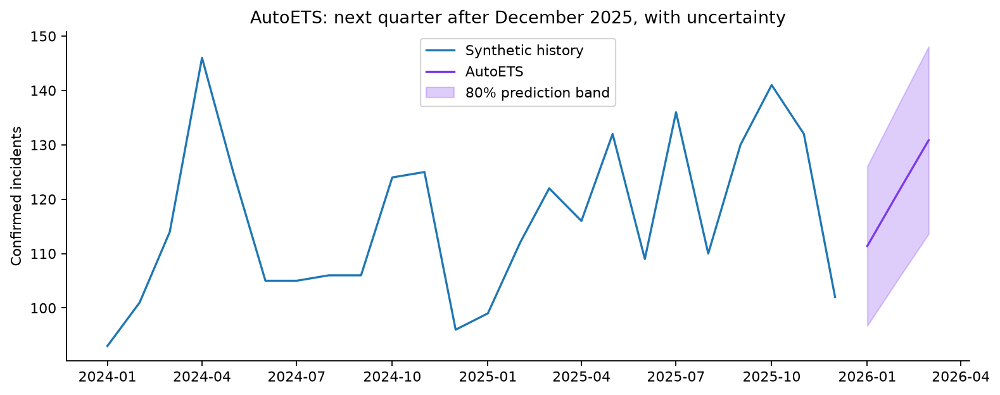

# Sibrawan - Manager report
Mashael Alotaibi

## 1. Decision and evidence

Use AutoETS provisionally for synthetic next-quarter capacity planning: rolling scaled CRPS 0.435, with observed 80% coverage 91.7%.

Sibrawan | Mashael Alotaibi. This is a synthetic experiment on 72 monthly counts, January 2020-December 2025. A confirmed phishing incident need not be a successful compromise. The evidence does not establish an ability to predict real attacks.

The series has a rising level and recurring annual variation. STL trend strength is 0.810 and seasonal strength 0.619. Raw annual-lag correlation is 0.494 at 12 months and 0.157 at 24 months; trend also contributes to that correlation.

We compared five real classical models in StatsForecast, an allowed alternative to AutoGluon. Eight expanding quarterly tests use exactly the same dates for every candidate: first history January 2020-December 2023; tests cover all quarters of 2024-2025, three months per quarter. No fold sees its future. The late three-month leaderboard is descriptive, not final ranking evidence.

MASE measures forecast error relative to typical year-on-year training change; below one beats that training scale. Scaled CRPS scores the prediction distribution (smaller is better), approximated from ten quantiles with trapezoidal integration and zero endpoint losses, divided by each fold's training seasonal-change scale. Both scores are equal means over eight tests.

| Model | MASE | Scaled CRPS | 80% coverage | 80% width |
|---|---:|---:|---:|---:|
| AutoARIMA | 0.677 | 0.507 | 79.2% | 28.8 |
| AutoETS | 0.538 | 0.435 | 91.7% | 31.3 |
| AutoTheta | 0.772 | 0.550 | 83.3% | 30.1 |
| Naive | 0.945 | 0.717 | 91.7% | 59.9 |
| SeasonalNaive | 1.078 | 0.768 | 79.2% | 42.4 |

AutoARIMA: MASE 0.677 vs floor 1.078 (wins); scaled CRPS 0.507 vs 0.768 (wins); 80% coverage 79.2%, width 28.8; point wins in folds [1, 2, 3, 4, 5, 6, 7], losses [8]; distribution wins [1, 2, 3, 4, 5, 6, 7], losses [8].

AutoETS: MASE 0.538 vs floor 1.078 (wins); scaled CRPS 0.435 vs 0.768 (wins); 80% coverage 91.7%, width 31.3; point wins in folds [1, 2, 3, 4, 5, 6, 7, 8], losses []; distribution wins [1, 2, 3, 4, 5, 6, 7, 8], losses [].

AutoTheta: MASE 0.772 vs floor 1.078 (wins); scaled CRPS 0.550 vs 0.768 (wins); 80% coverage 83.3%, width 30.1; point wins in folds [1, 2, 3, 6, 7, 8], losses [4, 5]; distribution wins [1, 2, 3, 6, 7, 8], losses [4, 5].

Naive: MASE 0.945 vs floor 1.078 (wins); scaled CRPS 0.717 vs 0.768 (wins); 80% coverage 91.7%, width 59.9; point wins in folds [2, 3, 6, 7], losses [1, 4, 5, 8]; distribution wins [2, 3, 6, 7], losses [1, 4, 5, 8].

## 2. Bands and what the forecasts missed

The floor covers 79.2% of held-out observations with mean 80% band width 42.4 incidents. AutoETS covers 91.7%, width 31.3. Below 80% is observed undercoverage; above it is conservative observed coverage. A narrow band is useful only when it covers adequately. With 24 targets, one observation changes coverage by 4.17 percentage points, so this is limited evidence of calibration.

Final-model selection was declared as lowest scaled CRPS among candidates covering at least 80%; if none qualified, nearest coverage then lowest CRPS. It is a retrospective choice on these tests, so its own reported performance may be optimistic. The notebook separately evaluates an adaptive policy selecting only from previously completed folds.

Floor annual-difference residuals: mean=10.07 (under-predicts on average), ACF(1)=-0.073, ACF(12)=-0.370; descriptive 95% reference +/-0.253; lag 1 is inside the approximate reference; lag 12 is outside the approximate reference. Positive mean exposes missed growth; differencing can induce negative annual-lag correlation. Trend-aware methods can address bias, while shocks can remain unexplained.

Quarterly forecast-error diagnostics: SeasonalNaive: mean=10.29 (under-predicts on average), ACF(1)=0.001, ACF(12)=-0.318; descriptive 95% reference +/-0.400; lag 1 is inside the approximate reference; lag 12 is inside the approximate reference; AutoETS: mean=-1.24 (over-predicts on average), ACF(1)=0.134, ACF(12)=-0.129; descriptive 95% reference +/-0.400; lag 1 is inside the approximate reference; lag 12 is inside the approximate reference. These errors mix three horizons and quarterly refits; their ACF is descriptive, not a formal independence test. Surges outside the bands are capacity risk. Values inside approximate ACF references do not prove randomness.

## 3. Next-quarter capacity and development

The selected AutoETS model is refitted on the complete unchanged record. The next months are January-March 2026, immediately after December 2025, rather than after the submission date. Forecast means may be fractional because they are expected counts. Prediction bands quantify uncertainty, not a guarantee.

Use the mean for ordinary workload planning and compare available response capacity with the upper 80% bound for a stress scenario. The upper bound is not a maximum; a larger surge is possible. The interface reports max(0, forecast mean - capacity), a planning proxy rather than the expected positive part of a full demand distribution.

One specific next step: collect consistently defined real monthly confirmed-incident counts and incoming suspicious-message volume; then backtest a lagged-volume regression against the same quarterly floor. Training-only driver joins are essential. This may explain workload surges; validation on real data is required before any operational recommendation.

Reproducibility: fixed seed 20261014, committed generator/CSV, clean-kernel notebook, identical rolling origins, training-only denominators and native model bands. No test-driven generator edits, interval calibration or hidden fallback model. API credentials are not needed for analysis. Optional Gemini explains saved numbers and offers sourced initial-response guidance; it cannot diagnose compromise or perform changes.

| Month | Mean | 80% low | 80% high | 95% low | 95% high |
|---|---:|---:|---:|---:|---:|
| 2026-01 | 111.4 | 96.7 | 126.0 | 89.0 | 133.8 |
| 2026-02 | 121.7 | 105.7 | 137.7 | 97.2 | 146.1 |
| 2026-03 | 130.8 | 113.6 | 148.0 | 104.5 | 157.2 |

